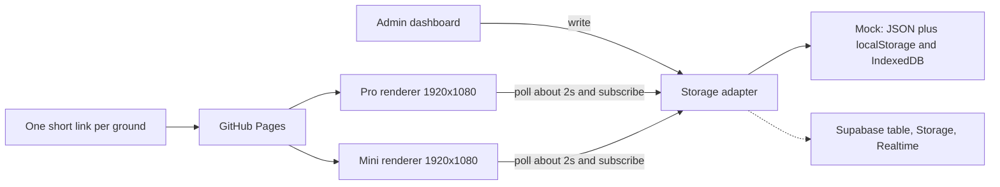

# Pulse Play YoloBox overlays

Remote control for the overlay pages that YoloBox Pro and YoloBox Mini load in their built-in browsers during Pulse Play broadcasts of Cheetahs Cricket Club games on the CricketCrazeUSA YouTube channel.

Vanilla HTML, CSS, and JavaScript. No build step. This slice does not create a Supabase project and does not contain credentials.

The admin page only writes this browser's `localStorage` and `IndexedDB`. It cannot change what a YoloBox on another device is showing until the Supabase adapter below is added.

## Architecture

The unit is a **ground**, not a stream. Each ground has one short link. That link redirects to a GitHub Pages renderer URL keyed by ground id and device, for example `renderer/pro.html?ground=cheetahs-home&device=pro`.

Two views stay in the DOM the whole time:

1. **View 1, Logos + Score.** PNG logos in fixed corners, and the CricClubs match overlay for that ground in the bottom center.
2. **View 2, Ad.** Logos and the score overlay fade out. The selected MP4 plays, with audio left on. Logos + Score brings View 1 back. By default the video also returns to View 1 when it ends.



```mermaid
sequenceDiagram
  participant Admin
  participant Store as Adapter
  participant Box as YoloBox renderer
  Admin->>Store: write mode=ad, active_ad
  Store-->>Box: push when the adapter has one
  Note over Box: CSS opacity crossfade, about 250ms
  Box->>Box: unmute and play the preloaded MP4
  Box->>Store: on ended, if auto-return, write View 1
```

### Storage adapter

`js/storage.js` exposes `read`, `write`, `subscribe`, `mediaUrl`, `putBlob`, and `deleteBlob`.

| Piece | Mock in this repo | Later |
| --- | --- | --- |
| Config | `config/grounds.example.json`, then `localStorage` key `pulseplay.overlayConfig.v3` | `pp_grounds`, `pp_assets`, `pp_ground_ads`, `pp_settings` in the existing cheetahs-club project |
| Push | `subscribe()` listens for `storage` events from other tabs of this browser | Supabase Realtime on `pp_grounds`, same `subscribe(listener)`. The socket is optional; the 2 second poll still runs |
| Ads and logos | One `assets` list, `kind` `ad` or `logo`. Repo files, plus IndexedDB blobs for uploads (`src` starts with `idb:`) | One public Storage bucket `pulseplay-assets` and `pp_assets.kind` |
| Poll | Renderer re-reads every `poll_ms` (default 2000) in case a push is missed | Same poll, plain `fetch`, no supabase-js on the YoloBox |

`config/runtime.js` chooses the adapter. `adapter` is `"supabase"` now that the migration is applied on cheetahs-club. Add `?adapter=mock` to any page URL (admin or renderer) to use the local example config instead. The publishable key in that file is public client config.

The Supabase adapter (`js/supabase-store.js`) talks to the existing project `cheetahs-club` (`https://lutcbvzunjcosncvdyke.supabase.co`) with `fetch`, and falls back to `XMLHttpRequest` if `fetch` is missing. Renderers stay logged out and only GET. They do not load supabase-js. The admin page loads the supabase-js UMD build so it can offer **Sign in with Google**, with email and password underneath. Google returns to this `admin.html` URL with the query and hash removed. After either sign-in, the page reads `profiles.role` and, if it is not `admin`, shows “This Google account isn't a Pulse Play admin” and a sign-out button. Writes send the admin access token. Realtime is enabled on `pp_grounds` and the adapter opens a socket when `WebSocket` exists. The poll still runs, so a missed socket message still lands within about 2 seconds.

Supabase only redirects back to URLs on the Auth allowlist. The public settings API does not list that allowlist, and `/authorize` accepts any `redirect_to` (it checks later). The club app itself only sends people to `https://cheetahs-club.pages.dev/auth/callback`. Add these if they are not already there, or Google sign-in lands on the club Site URL instead of this dashboard:

- `https://chriskeys19-bot.github.io/pulseplay-cricketstream-overlays/admin.html`
- `https://chriskeys19-bot.github.io/pulseplay-cricketstream-overlays/**`

The migration is `supabase/migrations/20261119180000_pulseplay_init.sql`. It has been applied on cheetahs-club. It creates only new objects:

- `pp_settings` (one row: poll interval and the auto-return master switch)
- `pp_assets` (`kind` `ad` or `logo`, label, description, storage path, mime, size, logo type, auto-return)
- `pp_grounds` (identity plus `mode`, `active_ad_id`, `updated_at`, and the three logo asset ids)
- `pp_ground_ads` (which ads a ground may play)
- RLS: `anon` and `authenticated` can select. Insert, update, and delete require `private.current_role() = 'admin'`, the club helper that reads `profiles.role`. That function is not modified.
- Storage bucket `pulseplay-assets`, public read, 200 MB per object, MP4 / PNG / WebP / SVG / JPEG. Writes require the same admin check. The bucket shares the project's 1 GB Storage free tier with the club app. `20261119173233_pulseplay_jpeg_mime.sql` records the JPEG types already set on cheetahs-club.
- Adds `pp_grounds` to the `supabase_realtime` publication.

It does not alter club tables, policies, or functions. With only the `pp_settings` row present, the libraries explain that they are empty and a renderer opened for an unknown ground stays transparent.

Mock reads still fetch the JSON file with `?t=<timestamp>` so the browser does not cache the seed. After the first successful read, `localStorage` wins. **Reset mock store** clears `localStorage` and IndexedDB and loads the example file again. Supabase mode has no reset; an admin deletes rows from the dashboard.

### Switching

Both views are always mounted. The body class `mode-logos-score` or `mode-ad` changes opacity over 250ms. The score iframe is hidden, not removed, and its `src` is set only when `score_url` changes.

Assigned ads for the open ground are created up front as `<video preload="auto" muted>`. They stay muted until that ad is the one on screen, then the renderer unmutes and calls `play()`. Switching away pauses and rewinds them. It does not destroy the element.

Expected latency, after the click:

| Path | When the overlay hears about it | Plus the crossfade |
| --- | --- | --- |
| This browser, two tabs | The `storage` event, usually well under a second | 250ms |
| Push missed | The next poll, default 2 seconds (`poll_ms` on the config, also editable on Ground controls) | 250ms |
| YoloBox today | It only has the seed file. Laptop clicks do not reach it | — |
| YoloBox with Realtime | Network round trip, aimed at under a second | 250ms |

Autoplay with sound is often blocked until a user gesture. The renderer tries with sound, then retries muted if the browser rejects it. That needs a test on the YoloBox itself. YoloBox mixes browser audio with the HDMI game audio, so a spot with sound is what we want when the engine allows it.

When a video ends, the renderer writes `mode: logos_score` and `active_ad: null` if **both** the master switch `auto_return_on_end` and that ad's `auto_return` are true. That is the one write the renderer performs. Otherwise the last frame stays up until someone presses Logos + Score. Both switches default to on.

### Views

**View 1**

| Corner | Asset |
| --- | --- |
| Top left | Age group sponsor logo |
| Bottom left | Tournament logo |
| Bottom right | CricketCrazeUSA logo |
| Bottom center | Iframe of that ground's `score_url` |

Placeholder art is in the Logo Library (`assets/logos/`, including one SVG). Ground setup does not take a raw URL. Each corner is a picker: matching `logo_type` first, then any other logo. The shared CricketCrazeUSA asset is `logo-cricketcraze`. Uploads may be PNG, WebP, SVG, or JPG. JPG has no transparency, so it sits in a solid box on the stream. A PDF is not stored: the admin converts page 1 to a PNG (about 1000px on the long edge, transparent canvas) and uploads that.

**View 2**

Logos and the score slot fade out. The chosen MP4 fills the stage. Placeholder spots are in `assets/ads/` (about 70 KB, 12 seconds, with a short tone). Real commercials replace them from the Ad Library.

### Score embeds

`score_url` is the CricClubs overlay URL for that ground, or a site-root path such as `scores/board.html?...` while a real overlay URL is not ready. The board is only a stand-in so the bug shows a total. Query keys: `batting`, `bowling`, `score`, `overs`, `rr`.

CricClubs and many score hosts send `X-Frame-Options` or CSP `frame-ancestors`. The browser also blocks a cross-origin read, so the page cannot scrape the total. `cricclubs.com` is on a short deny-list so we do not wait on a frame that will be refused. Any other URL is still tried, and if it is blank after a few seconds the iframe is hidden and a link is shown. Command Center uses the same field and the same fallback.

Later, a small proxy or Supabase Edge Function can fetch the score server-side and return a same-origin snippet, if the score site's terms allow it.

### Ad Library and ground setup

**Ad Library** uploads an MP4 with a name and description, lists every ad with a preview, and can delete one. The file must be an MP4. On the live Supabase adapter, anything over 50 MB is refused because the free plan rejects it. With `?adapter=mock`, a file over 50 MB asks before it is saved in this browser. Uploaded ads show up in Ground setup's checklist. Deleting an ad pulls it off every ground.

**Logo Library** is the same pattern for images: name, description, type (Age Group Sponsor, Tournament, CricketCrazeUSA, or Other), preview, list, delete. PNG, WebP, SVG, and JPG are stored as uploaded. JPG shows a note that it has no transparency. A PDF is rendered with pdf.js (page 1) to a PNG preview, and that PNG is what gets saved.

**Ground setup** edits or adds a ground: name, id, short URL, device (YoloBox Pro or YoloBox Mini), CricClubs overlay URL, the three logo pickers, and the ads this game may play. The control view's buttons are only Logos + Score plus that ground's assigned ads. Saving recomputes `resolved_url`.

### Canvas size

Both encoders can go to 1080p (YoloLiv's Pro and Mini spec pages list 1080p among the live broadcast resolutions). The Mini's own panel is a 5.5-inch touchscreen. YoloBox's Web URL overlay does not scale a page to the widget by itself, and a page without an explicit size is often cropped. Operators should drag the Web URL widget to the full frame after pasting the short link.

This repo therefore uses an explicit stage and scales that stage to the viewport:

| Device | Stage | Why |
| --- | --- | --- |
| Pro | 1920×1080 | Full-HD program. Set the overlay widget to 1920×1080. |
| Mini | 1920×1080 | Same program size as Pro. `mini.css` only enlarges logos, the score bug, and type so they read on the Mini's 5.5-inch panel. |

Percentage-free pixel placement inside the stage keeps the corners stable. `renderer/overlay.js` scales the stage with `transform` so a widget that is not exactly that size letterboxes instead of cropping.

Background is transparent so the game video shows through View 1. Confirm on a device that the browser honors CSS transparency. If it paints opaque white, we need whatever chroma or composite control the firmware offers.

## Config schema

`config/schema.json` is JSON Schema draft-07. `config/grounds.example.json` is the seed: 4 ads and 10 grounds.

| Field | Notes |
| --- | --- |
| `poll_ms` | Fallback poll. Default 2000 |
| `auto_return_on_end` | Master switch for returning to View 1 |
| `assets[]` | Shared library. `kind` is `ad` or `logo`. See below |
| `grounds[].id` | Slug used in `?ground=` |
| `name` | Label |
| `short_link` | The one public URL for this ground |
| `resolved_url` | Pages URL the short link targets |
| `device` | `pro` or `mini` |
| `mode` | `logos_score` or `ad` |
| `active_ad` | Ad id, or `null` on View 1 |
| `score_url` | CricClubs overlay URL. Renderer and Command Center both use it |
| `logos` | Asset ids for the three corners, not file URLs |
| `ad_ids` | Library ids the control view may play |
| `updated_at` | ISO-8601 UTC, stamped on each write |

Example, home ground:

| Field | Value |
| --- | --- |
| Short link | `https://short.sg/pp-cheetahs-home` |
| Resolves to | `https://chriskeys19-bot.github.io/pulseplay-cricketstream-overlays/renderer/pro.html?ground=cheetahs-home&device=pro` |

`short.sg` values are placeholders. Point each real short link at that ground's `resolved_url`. Mode changes do not change the URL, so the YoloBox does not reload.

## Run it locally

`file://` will not work. The config is fetched with `XMLHttpRequest`.

```bash
python3 -m http.server 8080
```

From the repo root the pages talk to Supabase, which starts empty. To exercise the example grounds locally, add `adapter=mock`:

- Admin: <http://localhost:8080/admin.html?adapter=mock>
- Pro, Cheetahs home: <http://localhost:8080/renderer/pro.html?ground=cheetahs-home&device=pro&adapter=mock>
- Mini, Cheetahs home: <http://localhost:8080/renderer/mini.html?ground=cheetahs-home-mini&device=mini&adapter=mock>

Open the admin and the Pro overlay in two tabs of the same browser. On Ground controls, choose Cheetahs CC — Home (Pro). It should offer Logos + Score, Ad 1, and Ad 2 only. Click **Ad 1**. The overlay crossfades to the video without reloading, and the score iframe keeps its address. **Logos + Score** fades back. Leave an ad playing and it should return to View 1 when the file ends.

Command Center lists every ground. CricketCrazeUSA — Featured shows the CricClubs fallback instead of an empty frame. Click a card to open that ground's controls.

Ad Library is where a new MP4 is added. Ground setup is where it is assigned.

JavaScript is ES5-style: no modules, no import maps, no top-level await. Polling uses `XMLHttpRequest`. The renderer uses `classList` and IndexedDB for uploads.

## GitHub Pages

Serve the repo root from `main`. There is no build. `.nojekyll` stops Jekyll from running.

This project cannot turn Pages on by itself. After this pull request is merged, a repo admin needs to:

1. Open the repository on GitHub.
2. **Settings** → **Pages**.
3. **Build and deployment** → **Source**: Deploy from a branch.
4. **Branch**: `main`, folder **`/ (root)`**.
5. Save.

Once the first deploy finishes:

- <https://chriskeys19-bot.github.io/pulseplay-cricketstream-overlays/>
- <https://chriskeys19-bot.github.io/pulseplay-cricketstream-overlays/admin.html>
- <https://chriskeys19-bot.github.io/pulseplay-cricketstream-overlays/renderer/pro.html?ground=cheetahs-home&device=pro>
- <https://chriskeys19-bot.github.io/pulseplay-cricketstream-overlays/renderer/mini.html?ground=cheetahs-home-mini&device=mini>

Pages publishes `main` only, so this pull request does not change a live overlay. The admin page sends `noindex`. It still only changes the visitor's own browser.

## Layout

```
admin.html
admin.css
admin.js
index.html
renderer/pro.html
renderer/mini.html
renderer/overlay.js
renderer/overlay.css
renderer/pro.css
renderer/mini.css
js/storage.js
js/supabase-store.js
js/score-frame.js
config/runtime.js
config/schema.json
config/grounds.example.json
supabase/migrations/20261119180000_pulseplay_init.sql
scores/board.html
assets/logos/*
assets/ads/ad1.mp4 … ad4.mp4
```

## Roadmap

1. **Sign in once** as a club admin and add the real grounds, logos, and ads. Until then the libraries are empty and an unknown ground stays a transparent page.
2. **Real logos and commercials**, and a CricClubs overlay URL per ground. If those URLs refuse iframes, add a score proxy.
3. **On-device test** of transparent background, autoplay with sound, and Realtime versus the 2 second poll.

## Assumptions

- One config row per ground, and that row has one device. Home Pro and Home Mini are two grounds so each can have its own short link.
- `game_live` from the first sketch is gone. The overlay is View 1 or View 2.
- The YoloBox is pointed at the short link once. The short link already includes `?ground=` and `&device=`.
- Placeholder scores that are not CricClubs exist so the bug is visible before real overlay URLs are pasted in. Featured grounds point at `https://cricclubs.com/` to show the fallback.
